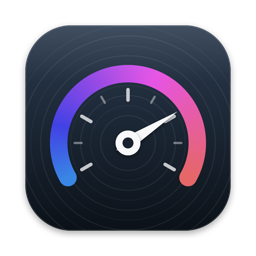
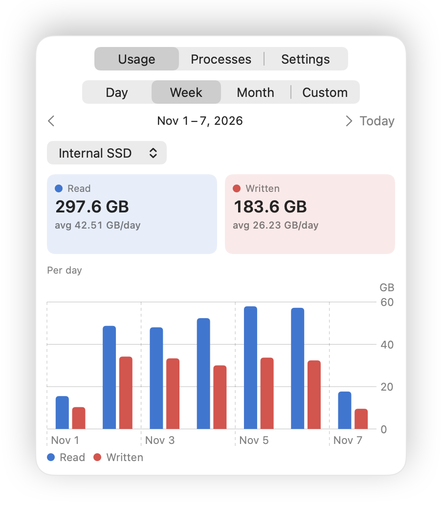
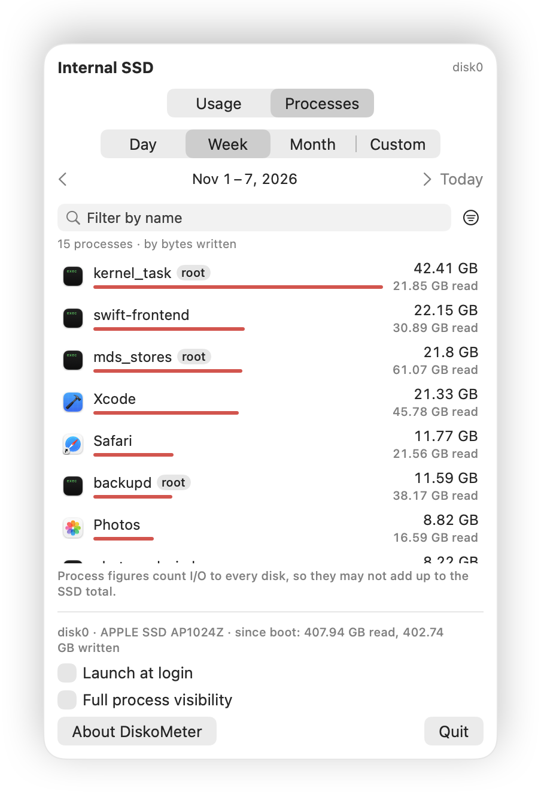
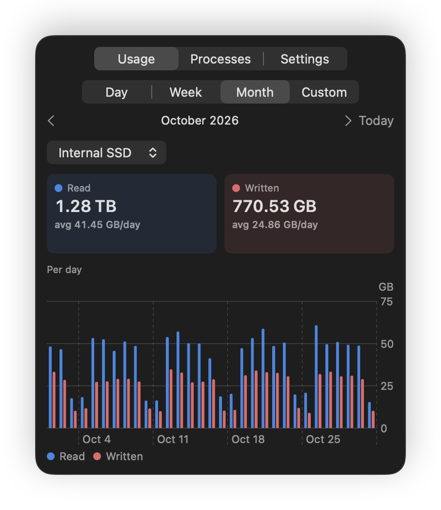
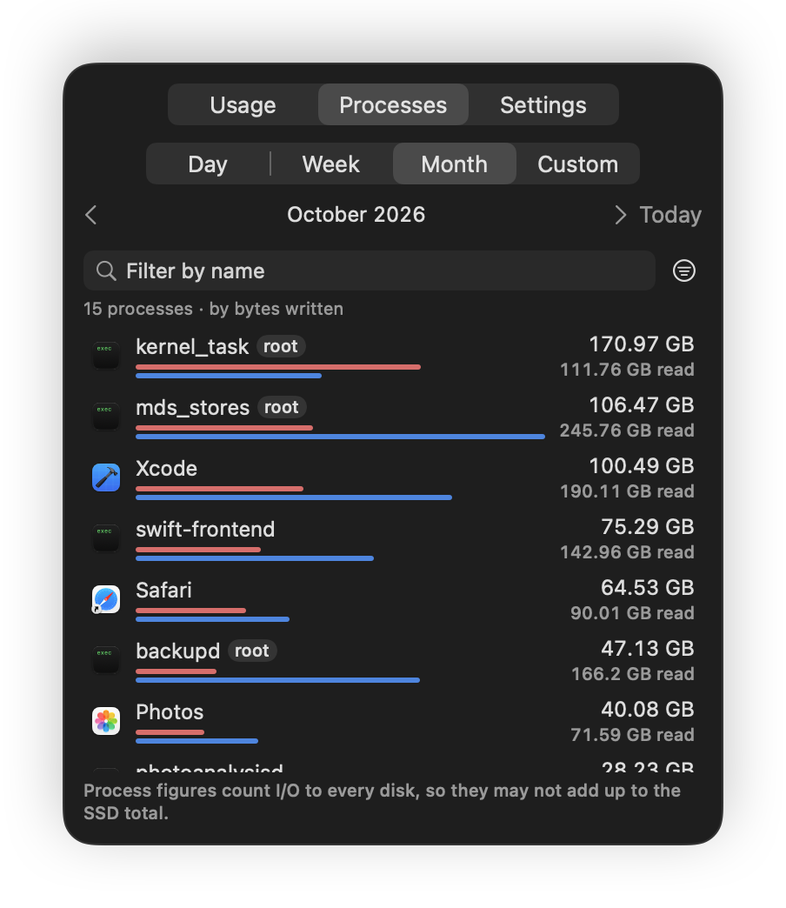

# Disk-O-Meter

A small menu bar app that shows how much your Mac's internal SSD and your external disks read and write each day, and which processes do the writing.

  
  

Every write wears an SSD a little, and on most modern Macs the drive is built in and can't be swapped when it wears out, yet macOS never tells you how much your machine actually writes in a day. Disk-O-Meter keeps that record from the menu bar, where it shows what has been written today, and a click opens a popover with the day, week, month or any range of days you choose, together with the processes behind the numbers.

## What you get

The menu bar shows today's writes to the internal SSD in three digits, such as `27.9 GB`, so a glance is enough to notice a day that is running hot, and the Settings tab lets you change what it shows, as described below. The Usage tab shows how much was read and written during the chosen period, with an average per day and a chart whose bars follow the length of the period, one pair for every hour of a single day, one for every day of a week or a month, and one for every week or month when you pick a long custom range. The arrows step back through earlier days, weeks and months, and Today brings you back to the present.

A menu at the top of the Usage tab switches between the internal SSD and your external disks, each of which keeps its own history from the moment Disk-O-Meter first sees it. A disk you have unplugged stays in the menu, so you can still look back at what it read and wrote while it was connected.

The Processes tab answers the next question, which is who did it. It lists every process that read or wrote during the same period, the biggest writers first, with a red bar for what each one wrote above a blue bar for what it read, and lets you filter the list by name and sort it by bytes written, bytes read, total I/O or name. It can also narrow the list to your own apps or to the system's background processes, such as Spotlight's `mds_stores` or Time Machine's `backupd`, which are often the busiest of all.

The Settings tab beside them holds Launch at login, the menu bar's options, write limits, Full process visibility, the About button and Quit, and when it needs more room than the other tabs, the popover grows to show every setting at once. Every tab follows the light or dark appearance you have chosen for macOS, as these month-long views in dark mode show.

  
  

## Choosing what the menu bar shows

The Menu Bar section of the Settings tab shapes the label beside the drive icon. It can stay on one disk or follow the disk you pick on the Usage tab, and it can show what was written, what was read, both side by side as `↓1.20 GB ↑3.40 GB`, or their total, either for today or as the current rate, such as `12.4 MB/s`. The number keeps two, three or four digits or rounds to whole units, the unit can be written in full, shortened to `27.9G` or left out, the decimal point can give way to your region's separator, and the icon can be hidden.

## Write limits

You can set up to two limits, each an amount a disk may write in a calendar day, week or month, such as 50 GB a day on the internal SSD or 1 TB a month on a backup disk. A bar under each limit shows how much of it the current period has used, and the Usage tab's Written tile shows the same share, such as `77% of 1 TB`. When a disk passes a limit, the menu bar label turns red until the period ends, and a notification tells you once per limit and period, which is why Disk-O-Meter asks for permission to send notifications when you add your first limit.

## Requirements

Disk-O-Meter needs macOS 26 or later on a Mac with Apple silicon.

## Download

The current version is 2.0.0, signed with a Developer ID and notarized by Apple. Download the disk image, which is the easiest way to install, or the ZIP archive, which holds the same app.

- [Disk-O-Meter-2.0.0.dmg](https://github.com/eugenezimin/Disk-O-Meter/releases/download/v2.0.0/Disk-O-Meter-2.0.0.dmg)
- [Disk-O-Meter-2.0.0.zip](https://github.com/eugenezimin/Disk-O-Meter/releases/download/v2.0.0/Disk-O-Meter-2.0.0.zip)

Every version is published on the [Releases](https://github.com/eugenezimin/Disk-O-Meter/releases) page together with a `SHA256SUMS.txt` that holds the checksums of both files, and the [release notes](RELEASE_NOTES.md) describe what each version brings.

## Installing

1. Open `Disk-O-Meter-2.0.0.dmg` and drag Disk-O-Meter onto the Applications folder beside it. If you downloaded the ZIP instead, double-click it and move the unpacked `Disk-O-Meter.app` into `/Applications`.
2. Open Disk-O-Meter from the Applications folder. Because it was downloaded from the internet, macOS asks once whether you want to open it, and since Apple has checked the app, a click on Open is all it takes.
3. Look for the drive icon in the menu bar and click it. To have Disk-O-Meter start with your Mac, turn on Launch at login on the Settings tab.

Until version 2.0.0 the app was called DiskoMeter, so updating from an earlier version takes a few more steps than usual. In the old app, turn off Full process visibility and Launch at login on the Settings tab and quit it, then move `DiskoMeter.app` from Applications to the Trash, because the two apps share one identity and shouldn't sit side by side. Install `Disk-O-Meter.app` as above, open it, turn both switches back on, and approve the helper again if macOS asks. Your history carries over by itself. Later updates, from 2.0.0 on, only need Full process visibility turned off before the app is replaced and turned on again afterwards.

Because Disk-O-Meter can only count from the moment it first runs, the first day is a partial one, and the history grows from there.

## Seeing system processes

macOS lets an ordinary app read the disk counters of your own processes only, which leaves out the system's background services, and those often write the most. To see them, turn on Full process visibility on the Settings tab, or click Enable Full Visibility on the Processes tab. Disk-O-Meter then installs a small helper that runs in the background with administrator rights, and macOS asks you to approve it under System Settings › General › Login Items & Extensions. The helper only reads the per-process counters, which are process names and byte counts, and hands them to Disk-O-Meter. It writes nothing and answers only Disk-O-Meter itself, signed by the same developer, and turning the switch off removes it again.

## Your data

Everything Disk-O-Meter records stays on your Mac, because the app makes no network connections and keeps its records in `~/Library/Application Support/DiskoMeter`, a folder that keeps the app's old name so the history carries over, as small JSON files, one for the daily totals of every disk, one per day for the hourly figures and one per day for the processes.

## What the numbers mean

The figures are what the Mac sends to and fetches from each disk, so they include everything that touches the drive, from apps and swap to Spotlight indexing, local Time Machine snapshots and system updates. They aren't the amount written to the flash chips inside an SSD, which is usually somewhat higher and which Apple's SSDs don't report. An external disk is counted only while it is connected and Disk-O-Meter is running, or earlier during the same connection.

The process list can't account for every byte, because a process that starts and quits within a few seconds may never be seen, some writes are made by the system on a process's behalf, and the per-process counters include external drives as well. That is why the list ends with an Other / unattributed row, and why its total may differ from the internal SSD's.

## Removing Disk-O-Meter

First turn off Full process visibility and Launch at login on the Settings tab, so neither the helper nor the login item is left behind. Then quit the app, move `Disk-O-Meter.app` from Applications to the Trash, and, if you don't want to keep the history, delete `~/Library/Application Support/DiskoMeter`.

## License

Disk-O-Meter is free to use and is released under the [MIT License](LICENSE). Copyright © 2026 Eugene Zimin. This repository holds the released app and its documentation, while the source code is kept private.
