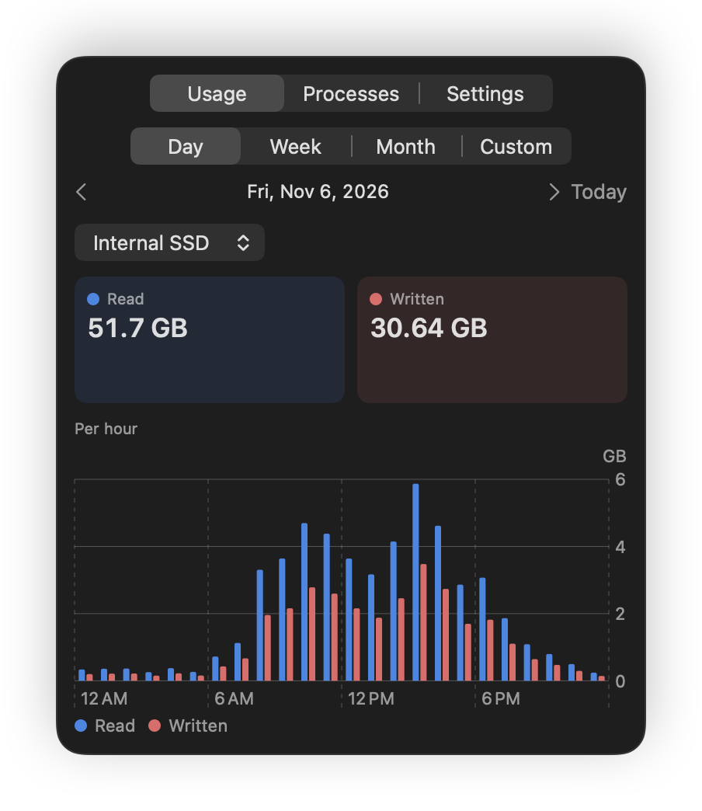
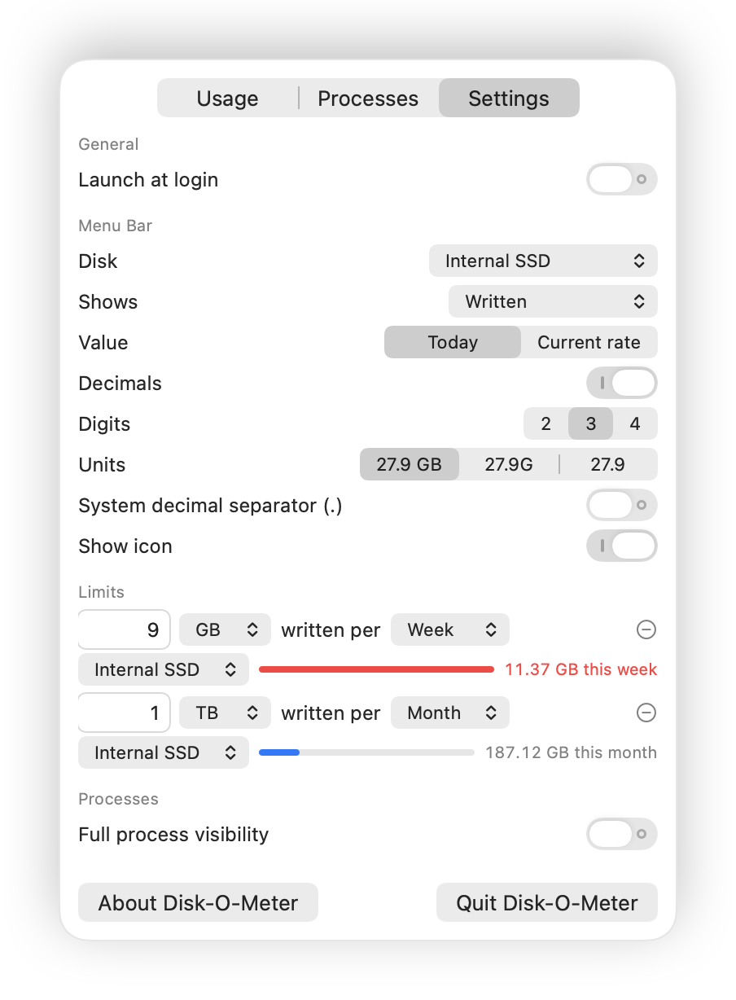

# Disk-O-Meter

Your Mac's SSD wears out a little with every byte written to it, and on most Macs it is soldered in for good. Disk-O-Meter lives in your menu bar and tells you, at a glance, how much of it you spent today.

  
  

<a href="https://github.com/eugenezimin/Disk-O-Meter/releases/download/v2.0.0/Disk-O-Meter-2.0.0.dmg">Download Disk-O-Meter 2.0.0</a> · free · macOS 26 or later on Apple silicon · signed and notarized by Apple

## A number worth a glance

macOS keeps quiet about how much your Mac writes, and the answer is often surprising, because a single afternoon of builds, photo imports, indexing and backups can easily cost more than a whole quiet week. Disk-O-Meter puts that figure next to the clock, where you can't miss it, and you decide how it looks, whether that is today's writes, what was read and written side by side, or the speed at which the disk is working right now.

  <picture>
    <source media="(prefers-color-scheme: dark)" srcset="screenshots/menubar-dark.png">
    
  </picture>

## Down to the hour

One click on the number opens the whole story, a day, a week, a month or any stretch of days you like, with a chart that zooms from months down to single hours. When yesterday looks heavy, you can see whether the writing happened during your morning meetings or at three in the afternoon, and every external disk you plug in keeps a history of its own, so the backup drive gets its own chart as well.

  
  

## Who did it

The Processes tab names the culprits. Every app and background service that touched the disk lines up with a red bar for what it wrote and a blue one for what it read, so the indexer that reads all day stands apart from the build tool that writes all night. With one switch Disk-O-Meter can also look at the system's own services, which are often the busiest writers on the machine.

  

## Set a budget

Tell Disk-O-Meter how much a disk may write in a day, a week or a month, and it keeps count for you. A bar shows how much of the budget is gone, and the moment you go over, the menu bar number turns red and a notification lets you know, once, without nagging.

  

## Installing

1. Download [Disk-O-Meter-2.0.0.dmg](https://github.com/eugenezimin/Disk-O-Meter/releases/download/v2.0.0/Disk-O-Meter-2.0.0.dmg), open it and drag Disk-O-Meter onto the Applications folder beside it. A [ZIP](https://github.com/eugenezimin/Disk-O-Meter/releases/download/v2.0.0/Disk-O-Meter-2.0.0.zip) with the same app is there too.
2. Open Disk-O-Meter from Applications and confirm once that you want to open an app from the internet.
3. Click the drive icon in the menu bar, and turn on Launch at login on the Settings tab so it starts with your Mac.

Disk-O-Meter counts from the moment it first runs, so your first day is a partial one and the story grows from there. Every version, with its checksums, is on the [Releases](https://github.com/eugenezimin/Disk-O-Meter/releases) page, and the [release notes](RELEASE_NOTES.md) tell what each one brought.

Disk-O-Meter used to be called DiskoMeter. If you have the old app, turn off Full process visibility and Launch at login in it and quit it, move `DiskoMeter.app` to the Trash, then install Disk-O-Meter and turn both switches back on. Your history comes along by itself.

## Private by design

Disk-O-Meter makes no network connections at all. What it records stays on your Mac in `~/Library/Application Support/DiskoMeter`, and it counts bytes, never what they contain. The optional helper that lets it see system services only reads process names and byte counts, answers nobody but Disk-O-Meter itself, and disappears again when you turn the switch off.

The numbers are honest about their limits. They count everything your Mac sends to a disk, the system's own housekeeping included, but not the extra work an SSD does inside itself, which no Mac reports. A process that comes and goes within a few seconds can slip past unseen, which is why the process list ends with a row for whatever nobody claimed.

## Removing Disk-O-Meter

Turn off Full process visibility and Launch at login on the Settings tab, quit the app and move it to the Trash. To forget the history too, delete `~/Library/Application Support/DiskoMeter`.

## License

Disk-O-Meter is free and released under the [MIT License](LICENSE). Copyright © 2026 Eugene Zimin. This repository holds the released app and its documentation, while the source code is kept private.
